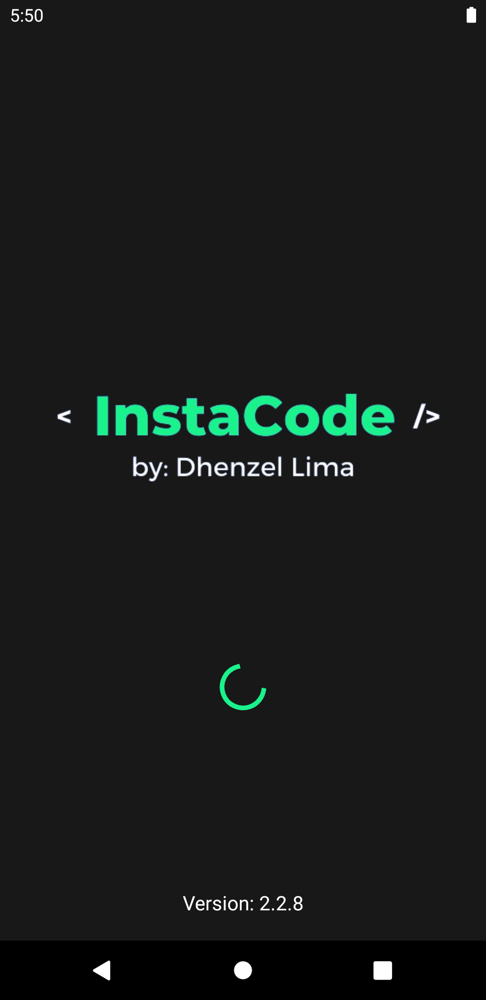
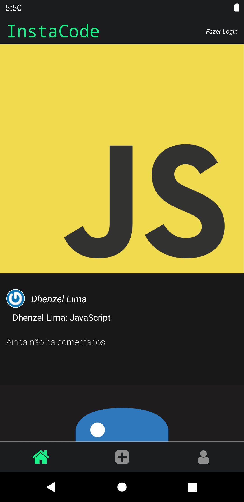
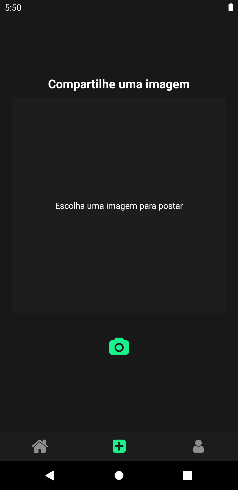
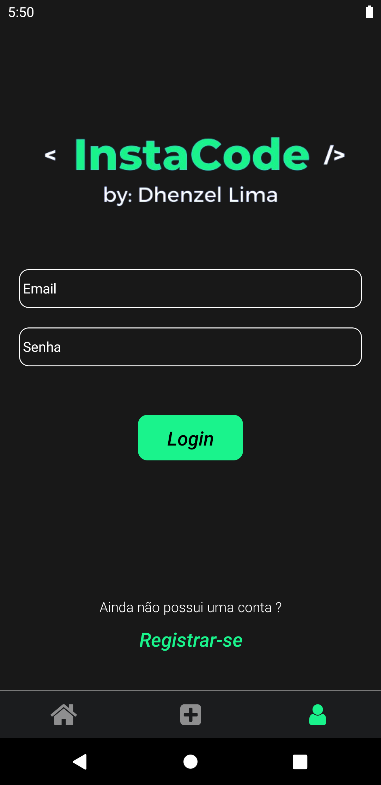
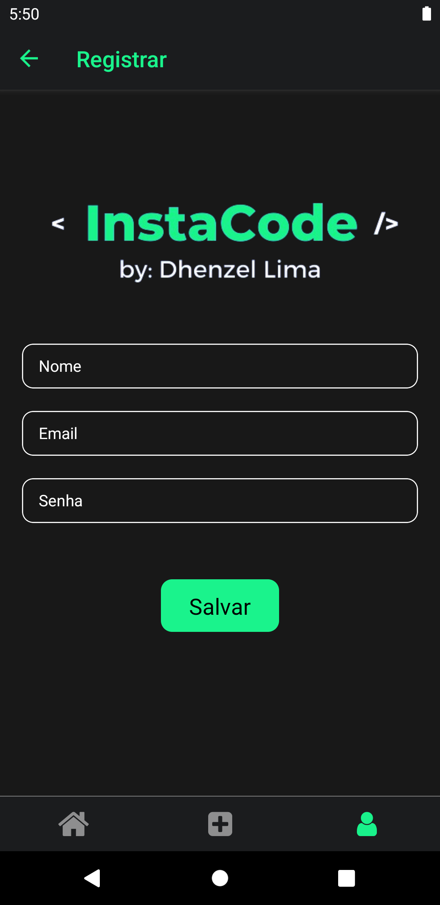

# InstaCode

Aplicativo mobile inspirado no Instagram, desenvolvido em **React Native**. Permite criar conta, fazer login, publicar fotos e vídeos, curtir, comentar, compartilhar posts e gerenciar o perfil do usuário.

O app consome a API própria [InstaCode-api](https://github.com/DhenzelNxs/InstaCode-api) (Python/Flask), hospedada em produção em `https://instacode-api.onrender.com/api`.

## Screenshots

<p align="center">
  
  
  
  
  
</p>

## Funcionalidades

- Cadastro e login de usuário
- Feed de posts com fotos e vídeos
- Curtir e descurtir publicações
- Comentar e visualizar comentários de um post
- Compartilhar posts (via WhatsApp, usando `react-native-share`)
- Publicar foto/vídeo tirado pela câmera ou escolhido da galeria
- Perfil do usuário com foto, posts publicados e logout
- Suporte a tema claro/escuro (segue o tema do sistema)

## Tecnologias

- [React Native](https://reactnative.dev) 0.74
- [React Navigation](https://reactnavigation.org) (stack + bottom tabs)
- [Redux](https://redux.js.org) + [Redux Thunk](https://github.com/reduxjs/redux-thunk) + React Redux
- [Axios](https://axios-http.com) para chamadas à API
- [react-native-image-picker](https://github.com/react-native-image-picker/react-native-image-picker) (câmera/galeria)
- [react-native-video](https://github.com/react-native-video/react-native-video) (reprodução de vídeos nos posts)
- [react-native-share](https://github.com/react-native-sharing/react-native-share)
- TypeScript, ESLint e Prettier
- Jest para testes

## Pré-requisitos

Siga o guia oficial de [configuração do ambiente React Native](https://reactnative.dev/docs/environment-setup) (React Native CLI) até a etapa "Creating a new application", garantindo o ambiente Android (Android Studio/SDK) e, no caso de iOS, o Xcode e o CocoaPods configurados.

## Instalação

```bash
git clone https://github.com/DhenzelNxs/InstaCode.git
cd InstaCode
npm install
```

Para iOS, instale também os Pods:

```bash
cd ios && pod install && cd ..
```

## Executando o projeto

Inicie o Metro Bundler:

```bash
npm start
```

Em outro terminal, rode o app no emulador/dispositivo:

```bash
# Android
npm run android

# iOS
npm run ios
```

> Por padrão o app aponta para a API em produção (`https://instacode-api.onrender.com/api`, definido em `index.js`). Para usar uma instância local da [InstaCode-api](https://github.com/DhenzelNxs/InstaCode-api), altere o valor de `axios.defaults.baseURL` nesse arquivo.

## Scripts disponíveis

| Script | Descrição |
| --- | --- |
| `npm start` | Inicia o Metro Bundler |
| `npm run android` | Builda e executa o app no Android |
| `npm run ios` | Builda e executa o app no iOS |
| `npm run lint` | Executa o ESLint |
| `npm test` | Executa os testes com Jest |

## Estrutura do projeto

```
src/
├── App.js              # componente raiz
├── Navigator.js         # rotas (stack + bottom tabs)
├── GlobalStyle/         # cores e estilos globais
├── components/          # componentes reutilizáveis (Post, Comments, Header, Video, etc.)
├── screens/              # telas (Feed, AddPhoto, Profile, Login, Register, Splash)
└── store/                # Redux: actions e reducers (user, post, message)
```

## Licença

Distribuído sob a licença MIT. Veja [LICENSE](LICENSE) para mais detalhes.
